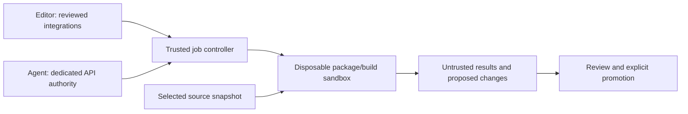

# Next hardening plan: contain malicious package execution

Status: proposed, not implemented. Recorded on 2026-10-24.

This plan proposes separate containers for editors, agents, and project packages. It
extends the [socket security review](socket-security.md). The
[validation record](hardening-validation.md#remaining-work) describes current protections
and open checks. This proposal adds no protection until implementation and boundary
tests pass.

## Objective and limits

Treat project dependencies and project-controlled commands as potentially
malicious. Restrict the resources they can affect even when scanning fails to
identify them as malicious.

The package environment must block access to editor and host integration sockets,
protected host and agent credentials, launch and control files, and the container
engine. Test each denial from the actual package environment before claiming
containment.

Socket isolation alone cannot make a malicious dependency harmless. Within its allowed
environment, a package can still corrupt writable files, change build results, consume
resources up to their limits, and use permitted network access. Permitted destinations
can accept uploads, so hostname enforcement cannot prevent all data exfiltration.

The proposal assumes the host, container engine, protected launcher, and approved
agent/editor binaries are trusted. Kernel/runtime exploits and compromise of
those trusted components remain outside the initial containment claim. An agent
can also misuse its own permitted API authority, including through prompt
injection. Package isolation does not eliminate that risk.

## Why separating agents alone is insufficient

Inventory every route that can execute package code, including editor tools and commands
outside the agent shell.

| Execution path | Required treatment |
| --- | --- |
| Installation and lifecycle hooks | Execute in the package sandbox, including their children. |
| `npx`, package binaries, tests, builds, and application runtime | Run imports, package binaries, tests, builds, and apps inside the same boundary as install hooks. |
| Linters, formatters, language-server plugins, debugging, and editor tasks | Route project-controlled execution into the sandbox or disable the integration in strict mode. |
| Agent tools, project configuration, plugins, and helper processes | Identify project-code execution in the agent runtime. Enforce separation or report the path unsupported. |
| Files returned to the editor or host | Require review before executing returned files in a more privileged context. |

npm installation can execute lifecycle scripts, and editor features can execute
workspace-provided programs. Disabling installation scripts covers only part of this
surface.
[npm lifecycle documentation](https://docs.npmjs.com/cli/v11/using-npm/scripts/),
[VS Code Workspace Trust](https://code.visualstudio.com/docs/editing/workspaces/workspace-trust).

A worker that also receives agent credentials still exposes those credentials
to package code running there. A shared writable checkout can carry a modified
script, executable, dependency, or configuration back into a more privileged
context. Both paths must be addressed before claiming containment.

## Proposed execution boundaries

Start with three separate containers managed by trusted host tooling. Evaluate another
boundary only when it passes the same containment and workflow tests.

| Environment | Intended authority | Required separation |
| --- | --- | --- |
| Editor | Reviewed editor integrations and source review/editing | Project commands and package-provided tools do not execute directly with editor socket/credential access. |
| Agent runtime | Dedicated agent API credentials and controlled tool requests | No editor/host integration sockets. Project command execution goes through the package sandbox. Package jobs receive neither agent state nor agent credentials. |
| Package/build sandbox | A selected project snapshot, private dependencies/scratch, and the required egress policy | No editor/agent homes, forwarded credentials, engine socket, host process filesystem, or privileged orchestration interface. |

The controller enforces the job policy. Its interface must accept only bounded job
requests. Reject project-supplied host shell commands, Compose files, mount sources,
privilege flags, and container-engine API operations. Workers must not be able to change
their launch policy or create jobs with more privileges. Keep host orchestration outside
the editor, agent, and package containers so none requires a Docker socket.

This architecture remains a proposal until command routing is enforceable.
Changing PATH, adding shell aliases, clearing environment variables, or asking
an agent to use a runner is insufficient when direct execution remains possible.
If a supported agent/editor cannot enforce the required routing, strict mode
must reject that integration or adopt a different credential/execution design.

## Source, dependency, and result handling

Use a selected source snapshot for each job and private writable job storage.
Do not expose a live editor workspace containing editor sockets, dependency
executables, or mutable control configuration as an unrestricted shared mount.
Preserve source editing through an explicit staging and promotion workflow.

Dependencies, generated executables, package caches, and worker-produced
configuration remain untrusted. The editor must not automatically load a linter,
formatter, plugin, executable cache, or script written by the worker into its
own privileged context. Read-only mounts alone do not make such execution safe.

Bind reviewed changes to a fixed tree or content identity so a running worker
cannot alter them between review and promotion. Preserve the existing protected
Git/control-file rules and reviewed exports. Do not import worker hooks, Git
configuration, or launch configuration as trusted host state.

The strict initial prototype should use disposable snapshots. Any later live
sharing mode must document and test the resulting cross-context execution paths
and weaker guarantees separately.

## Implementation sequence and task checklist

All tasks below are pending. Complete each task only after recording evidence for its
required behavior. A working launcher or accepted socket warning alone does not satisfy
the containment requirements.

### Phase 1: define and prove the boundary

- [ ] Inventory direct terminal commands, package managers, lifecycle scripts,
  agent tools, IDE tasks/debuggers, language servers, formatters, and plugins.
  Record their process identity, mount view, credentials, and socket exposure.
- [ ] Define the exact strict-mode execution contract and trusted components.
  Separate permitted workspace damage from prohibited cross-boundary access.
- [ ] Check each supported agent's command hooks and project/plugin loading.
  Prove that project execution cannot fall back into its credential-bearing
  runtime. Record unsupported launch paths explicitly.
- [ ] Identify editor features that execute project code. Choose enforceable
  worker routing or explicit disablement for each feature in strict mode.
- [ ] Specify the controller's authentication, job schema, policy ownership,
  allowed mounts, command handling, time/output limits, and cancellation behavior.
- [ ] Build a disposable Node prototype that demonstrates separation using the selected
  host's measured ABI without assuming a kernel upgrade.

Integrate strict mode only after tests exclude direct-execution and controller bypasses.
Revise the architecture and its claims if those tests expose a gap.

### Phase 2: constrain package jobs

- [ ] Give jobs private home, scratch, dependency/cache, process, and runtime locations.
      Review Unix sockets in shared source paths as well as `/tmp`.
- [ ] Exclude editor/agent homes, host process views, host credentials, forwarded
  agent/display sockets, and container-engine endpoints from worker mounts.
- [ ] Use an explicit environment allowlist and review inherited file descriptors
  and other credential sources. Environment cleanup alone is insufficient.
- [ ] Apply unprivileged runtime controls, protected enforcement assets,
  no-new-privileges, and suitable seccomp/capability restrictions.
- [ ] Give package jobs a reviewed egress policy separate from agent API access.
  Verify role separation through trusted topology/configuration, not client-
  supplied role headers or environment labels.
- [ ] Define private-registry access when needed. Use narrowly scoped job access or a
      reviewed download mechanism. Keep general host/agent tokens out of jobs and
      prevent lifecycle scripts or logs from exposing fetch credentials.
- [ ] Bound job lifetime, CPU, memory, process count, scratch, output, and storage.
  Record host quota requirements where disk bounds cannot be enforced.
- [ ] Define cleanup, cancellation, concurrent jobs, cache contamination, and
  recovery after interrupted execution without deleting unrelated user data.

### Phase 3: control results and editor execution

- [ ] Implement source snapshot selection, writable job staging, and explicit
  result collection with validation of paths, symlinks, and control files.
- [ ] Keep dependency directories and executable caches out of the editor's
  trusted execution paths. Define safe handling for logs and generated artifacts.
- [ ] Route supported IDE tasks, debugging, linting, and formatting through the
  worker. Disable unsupported project execution in strict mode.
- [ ] Preserve usable review/edit workflows without automatically trusting or
  executing worker-modified files. Workspace Trust can assist the workflow but
  is not the enforced package boundary.
- [ ] Require review and explicit promotion of a fixed candidate tree before
  using its scripts or configuration in a context with greater authority.
- [ ] Validate normal install/build/test and development-server workflows before
  extending the implementation to the other language variants.

### Phase 4: add evidence to doctor and integration tests

- [ ] Define role-specific diagnostics for the editor, agent runtime, and package
  jobs. Verify actual mounts, process identity, credentials, and enforcement
  instead of trusting a caller-supplied role label.
- [ ] Run direct known-path connection attempts from malicious-package fixtures
  and their child processes. Include discovered, renamed, aliased, and deliberately
  exposed test sockets, with environment variables removed during some checks.
- [ ] Verify editor functionality and package denial together after initial
  attachment, reconnect, rebuild, and extension changes.
- [ ] Use dummy credential sentinels and harmless fake agent/editor services to
  test denied reads and protocol access without consulting real host credentials.
- [ ] Prove that worker policy, control configuration, privileged mounts, engine
  access, and agent credential state cannot be changed or reached by a job.
- [ ] Test direct interpreter execution and raw package-manager binaries as well as
      supported shims. Require the same containment when callers bypass the shim.
- [ ] Verify that worker-modified scripts, dependencies, and plugins do not execute
  automatically in the editor or agent context. Include concurrent mutation
  between result review and promotion.
- [ ] Treat writes within the job’s permitted project as expected behavior. Report
      protected-file access as a boundary failure.
- [ ] Keep accepted editor socket warnings separate from worker isolation results.
  A socket approval must never turn a worker boundary failure into a pass.

Require successful supported workflows and denied cross-boundary operations. Use live
harmless services that remain reachable from their intended context. A missing endpoint
or stopped fixture cannot establish enforced denial.

### Phase 5: integrate and document strict mode

- [ ] Integrate the validated topology and protected launcher with preparation,
  setup, patching, and runtime checks. Preserve existing workspace data and mode
  until an explicit migration selects the new arrangement.
- [ ] Make strict mode reject unsupported enforcement or launch paths. Document
      compatibility-mode exposure separately and require explicit selection before
      relaxing enforcement.
- [ ] Record the supported host/kernel/editor and language workflow matrix.
  Retain open items when a platform or variant has not been exercised.
- [ ] Document credential provisioning, editor limitations, job lifecycle,
  review/export, migration, rollback, and recovery using tested procedures.
- [ ] Publish results and residual risks in the validation record. Claim only
  the protections demonstrated in the selected mode and execution contexts.

## Optional additional controls

Evaluate the following options after baseline boundary tests pass.

| Candidate | Evaluation requirement |
| --- | --- |
| Separate UIDs and restrictive socket directories | Prove the package identity cannot change permissions, adopt the editor identity, or reach alternative endpoints. Same-user permission changes alone are insufficient. |
| Per-process seccomp restrictions on Unix-socket creation | Test inherited descriptors, alternate syscall paths, and compatibility before applying restrictions to each process. |
| Newer Landlock pathname-socket enforcement | Require compatible kernel and userspace support, suitably narrow path rules, and live denial tests. Raising the ABI while broadly granting `/tmp` access is not sufficient. |
| A credential broker outside package execution | Permit only reviewed operations and destinations. Exclude general secret-return and host-execution methods. Available API authority can still be abused. |

Evaluate each candidate against the complete execution boundary. All remain
unimplemented.

## Acceptance criteria

Complete the first Node workflow when all five criteria below pass. The boundary limits
package authority while leaving malicious behavior within permitted resources possible.

1. Install hooks, package binaries, tests/builds, and supported project tools run
   within the enforced package boundary, including descendants.
2. Live test editor/host sockets and dummy host/agent credentials are accessible
   only from their intended contexts and denied to package jobs.
3. A package cannot bypass the controller, acquire engine access, alter protected
   launch policy, or arrange automatic privileged execution of its returned files.
4. Reviewed editor/agent workflows remain usable, and unsupported routes fail
   clearly in strict mode.
5. Workspace corruption, malicious outputs, permitted network use, resource
   limits, trusted-component assumptions, and untested platforms remain explicit.

Start implementation with Phase 1’s execution inventory and disposable prototype. Socket
approvals remain a separate host action under the existing policy.
