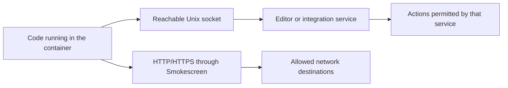

# VS Code and host socket security

Reviewed on 2026-10-24 for didcon. The attached-container observations used
VS Code 1.142.0 and Dev Containers 0.469.0 on Windows/WSL2 with Docker Desktop.
Forwarding behavior can change with the editor, extension, host, and settings.

Reachable integration sockets let container processes contact editor,
credential, display, or other services. Some are expected during normal VS Code
use. Their security impact depends on the service's authority and protocol,
including authentication and permission checks.

**A socket FAIL reports reachable exposure or unverified isolation. It
does not establish credential theft, desktop access, or host command execution.**
Likewise, approving a path records acceptance of exposure; it adds no isolation.
The risk scenarios below are inferences from service capabilities, not confirmed
exploits against the attached container.

- [Scope and threat model](#scope-and-threat-model)
- [Interaction with didcon protections](#interaction-with-didcon-protections)
- [Socket inventory and risks](#socket-inventory-and-risks)
- [Disable optional integrations](#disable-optional-integrations)
- [Verify the actual result](#verify-the-actual-result)
- [Approve selected exposures](#approve-selected-exposures)
- [Evidence and remaining uncertainty](#evidence-and-remaining-uncertainty)

## Scope and threat model

Assume an agent, extension, dependency installation script, or project command
can run untrusted code as `dev`. A socket that the ordinary `dev` terminal can
reach may also be available to those processes. The approval file does not
distinguish an interactive developer from an agent or a package lifecycle child.
Actual sandbox restrictions must be tested in each relevant execution context.

A Unix socket is a local communication endpoint. A path such as
`/tmp/vscode-ipc-example.sock` names that endpoint; it does not describe all the
actions the listening process can perform. Access can depend on directory and
socket permissions, process credentials, and application authentication. A
connection can succeed before the service checks protocol credentials.
[Linux Unix-socket documentation](https://man7.org/linux/man-pages/man7/unix.7.html).

The server may run inside the container, in WSL, or on another host component.
Even a container-local listener may relay requests to an editor or host service.
A socket filename alone does not identify that destination or prove its
authority. Random UUIDs in paths are not a substitute for access control.

## Interaction with didcon protections

The container has more than one route to services:



The diagram describes separate communication paths, not a claim that every
socket reaches the host or permits arbitrary commands.

| Existing control | What it does for this risk |
| --- | --- |
| Smokescreen hostname and TLS enforcement | Governs traffic through the HTTP/HTTPS proxy. It does not filter Unix-socket messages. A host-side helper or browser may make its own network requests under a different policy. |
| Network guard and dropped network capabilities | Restrict container IP networking and network changes. They do not provide a protocol policy for reachable pathname Unix sockets. |
| Protected Git/editor control mounts | Prevent changes through reviewed filesystem paths. They do not constrain every operation exposed by an already running service. |
| Read-only bind mounts | Protect filesystem updates through the mount. Do not interpret a read-only socket mount as a read-only protocol; the earlier [Wayland probe](hardening-validation.md#first-attached-ide-checks-2026-10-24) reached such a mount. |
| Current Island/Landlock profiles | Request ABI 6 and do not establish pathname Unix-socket connection isolation. A filesystem read denial is not proof of socket connection denial. |
| Volume workspace mode | Separates workspace writes from the host checkout. Forwarded editor, agent, and display services still require separate review. |
| Socket approval file | Changes the diagnostic treatment of exact paths. It does not change socket permissions, service methods, authentication, or network rules. |

Landlock behavior depends on both kernel support and the rights actually handled
by the sandbox. The observed host exposed ABI 3. A newer kernel alone does not
prove that the current profiles isolate sockets; require an enforced policy and
actual connection-denial tests before making that claim.
[Landlock documentation](https://docs.kernel.org/userspace-api/landlock.html),
[didcon validation record](hardening-validation.md#container-doctor-2026-10-24).

## Socket inventory and risks

These names are examples and discovery hints, not identities or automatic
approval rules. Socket names and locations can change on reconnect.

| Socket or family | Normal purpose | Exposure to review | Operational choice |
| --- | --- | --- | --- |
| `vscode-ipc-*.sock` | Editor/CLI communication, such as container-side `code` commands | Requests to open files, folders, or external URLs, and extension-management operations where the endpoint permits them | Retain the reviewed paths needed for the chosen IDE workflow. |
| `vscode-remote-containers-ipc-*.sock` | Dev Containers integration bridge | Access to the helper operations or forwarded services that this installation exposes | Review its actual handlers and destination before accepting its authority. |
| `vscode-git-*.sock` | Git extension IPC, including authentication and Git editor integration | Credential-provider/cache access or prompts; editor actions supported by the Git integration | Disable the Git extension if its integration is unnecessary. |
| `/tmp/.X11-unix/X0` | X11 display forwarding | With authorized, trusted X11 access, observation or interference within the shared X session | Disable display forwarding when container GUI applications are unnecessary. |
| Wayland sockets, including `vscode-wayland-*` | Wayland display forwarding | Compositor interaction and the protocols made available to the client | Disable the automatic mount when container GUI applications are unnecessary. |

### Editor CLI sockets

The upstream VS Code CLI server accepts requests to open files/folders, open
external URIs, report status, and manage extensions. This explains why the
endpoint should be treated as a control interface. Feature availability and
the local/remote target still depend on the running implementation.
[VS Code CLI server source](https://github.com/microsoft/vscode/blob/main/src/vs/workbench/api/node/extHostCLIServer.ts).

An inferred risk is that untrusted code requests an editor or external-browser
action that the user did not intend. Where extension installation is permitted,
it may introduce code in the relevant extension host. This is not evidence that
each `vscode-ipc-*` endpoint permits arbitrary host shell execution or unrestricted
host-file reads. Several listeners can serve different processes or sessions;
their presence does not establish that every one is required for basic attachment.

### Dev Containers bridge sockets

The inspected Dev Containers extension creates a container helper endpoint and
sets `REMOTE_CONTAINERS_IPC`. This is distinct from the VS Code CLI endpoint.
Its potential consequences depend on the helper methods, forwarding settings,
and host components participating in the bridge.

The attached-container checks established reachability, not a complete inventory
of callable host operations. Host command execution and credential retrieval
through this bridge remain unverified. Review the installed version's handlers
before attributing either capability to a particular listener.
[Local inspection and validation](hardening-validation.md#rebuild-follow-up-separate-wsl-forwarding-control-2026-10-24).

### Git integration sockets

The Git extension's askpass implementation can consult credential providers,
temporarily cache returned credentials, and display authentication prompts.
If such credentials are available to an untrusted caller, repository operations
could acquire the authority of those credentials. Socket reachability alone
does not establish that a provider will return a usable token.
[Git authentication source](https://github.com/microsoft/vscode/blob/main/extensions/git/src/askpass.ts).

Disabling Dev Containers credential-helper forwarding does not necessarily
remove the Git extension's own listener. Conversely, retaining the listener
does not prove that host credentials are configured behind it. Review listener
exposure and credential configuration separately.

### X11 forwarding

X11 authentication and its trusted/untrusted client distinction matter. With
trusted access, a client may observe other clients' windows or input and
interfere with the session. Authentication or additional access controls can
limit this; the Unix connection probe does not perform the X11 handshake.
[X.Org access-control documentation](https://www.x.org/Development/Documentation/Security/),
[X.Org communication and security model](https://www.x.org/guide/communication/).

The relevant scope is the accessible X session. A reachable WSLg/X11 relay is
not proof that the process can observe every native Windows application or the
entire Windows desktop. The server, authentication, and session boundaries
would need separate verification.

### Wayland forwarding

Wayland's core model separates clients' surfaces; access to a Wayland socket
does not by itself imply global screenshots or keyboard monitoring. Available
extensions and compositor policy determine additional capabilities. Creating
GUI windows or interacting with exposed display services still expands the
container's integration with the desktop.
[Wayland protocol model](https://wayland.freedesktop.org/docs/book/Protocol.html).

Wayland and X11 are separate paths. Disabling one does not establish isolation
from the other.

### Related agent and container-engine sockets

The following services deserve separate review even when they were absent from
the reported socket list:

| Service | Risk and intended handling |
| --- | --- |
| SSH agent (`SSH_AUTH_SOCK`, `vscode-ssh-auth-*`) | A caller may use loaded identities for authentication, subject to agent/key constraints. Private-key extraction is not necessary for misuse. Disable unnecessary forwarding. [OpenSSH agent documentation](https://man.openbsd.org/ssh-agent). |
| GPG agent (`GPG_AGENT_SOCK`, `S.gpg-agent*`) | Exposes cryptographic operations such as signing or decryption, subject to the selected socket's command restrictions and agent confirmation/unlock policy. Disable unnecessary forwarding. [GnuPG agent protocol](https://www.gnupg.org/documentation/manuals/gnupg/Agent-Protocol.html). |
| Docker/Podman engine socket | Can expose container and mount management under the engine's authority. A rootful Docker daemon can provide extensive host control; rootless engines have a different authority scope. Keep these sockets out of the development container. [Docker daemon security](https://docs.docker.com/engine/security/#docker-daemon-attack-surface). |

Doctor checks common engine socket paths separately. Adding one of those paths
to the integration allowlist does not waive the separate engine-socket failure.

## Disable optional integrations

### Configure the host extension

In the VS Code instance that launches Dev Containers, open **Preferences: Open
User Settings (JSON)** and merge these entries into the existing object. On
Windows/WSL, this is the Windows VS Code profile used to open the container.

```json
{
  "dev.containers.dockerCredentialHelper": false,
  "dev.containers.gitCredentialHelperConfigLocation": "none",
  "dev.containers.copyGitConfig": false,
  "dev.containers.mountWaylandSocket": false,
  "dev.containers.forwardWSLServices": false,
  "remote.autoForwardPorts": false
}
```

The five `dev.containers.*` entries configure the host extension. In the inspected
0.469.0 package, the Wayland/WSL settings have application scope and the three
credential/Git-copy settings have machine scope. Their copies were removed from
the template's `customizations.vscode.settings` to avoid suggesting that they
configure the parent host there. That section supplies container-specific editor
settings. [Dev Containers settings specification](https://containers.dev/supporting.html).

`remote.autoForwardPorts: false` is also valid for the attached editor and remains
in the container template. It controls automatic TCP port forwarding, not the
Unix sockets listed above.

`setup.sh` and `patch.sh` update project files, not host VS Code user settings.
`patch.sh` preserves existing generated `devcontainer.json` files. Remove any old
copies of the five host-extension settings from their container customizations
when cleaning up an existing installation; retain the host user settings.

### Stop display forwarding before attachment

| Control | Location | Verified scope in Dev Containers 0.469.0 |
| --- | --- | --- |
| `dev.containers.mountWaylandSocket: false` | Host VS Code user settings | Prevents the automatic Wayland bind mount. |
| `dev.containers.forwardWSLServices: false` | Host VS Code user settings | Excludes an additional WSL forwarding host. A primary CLI host that is already WSL still participates. |
| Nonempty `DISPLAY=disabled` | Container environment before attach | The inspected extension skips creating its automatic X11 relay. |

Didcon already supplies DISPLAY in the template and as a default in the proxy
Compose generator. An explicit project DISPLAY value is preserved. The startup
decision was checked against the installed extension's relay-creation code;
fresh-attach socket denial still requires a runtime check.

For an existing installation, apply `patch.sh`, follow its host preparation and
rebuild instructions, and recreate the container before verifying the result.
An image build without cache does not change host user settings. Clearing
DISPLAY, agent variables, or browser helpers in an already running terminal does
not remove existing mounts/listeners or prevent known-path connection attempts.

### Disable optional Git integration

In the attached container window, open Extensions and find the built-in **Git**
extension (`vscode.git`). Choose **Disable (Workspace)** and restart the extension
host when prompted. This disables the editor's Git integration for that workspace;
the installed terminal `git` command remains available.
[VS Code extension management](https://code.visualstudio.com/docs/configure/extensions/extension-marketplace#disable-an-extension).

`git.terminalAuthentication: false` and `git.useIntegratedAskPass: false` reduce
authentication integration. They should not be treated as listener-removal
controls: the extension creates an IPC server separately from its askpass
behavior. Restart and test actual reachability after changing the integration.
[Git extension initialization](https://github.com/microsoft/vscode/blob/main/extensions/git/src/main.ts).

### Choose which editor exposure to retain

Normal VS Code use can retain editor and Dev Containers IPC even with optional
credential and display forwarding disabled. Review those paths if the chosen
workflow needs them. A workflow requiring verified socket isolation needs
additional controls or a different editor/remote execution arrangement.

A dedicated host account, remote machine, or VM can reduce the authority exposed
to an untrusted workload, provided the sensitive integrations are not forwarded
back into it. A different container runtime alone does not remove a forwarded
credential or display service.

## Verify the actual result

Run these as `dev` in an ordinary container terminal after post-create completes
and after IDE attachment. Repeat after reconnect, extension changes, and host
forwarding changes:

```sh
didcon-doctor
node /opt/scripts/host-integration-check.js --json
node /opt/scripts/host-integration-check.js --socket /path/to/known/socket
```

Use `didcon-doctor --offline` when external requests are unavailable; local
socket checks still run, but live egress coverage is marked incomplete.

The socket probe attempts a Unix stream connection and closes it. It sends no
Git, editor, display, or agent protocol requests. The default integration check
also reviews mounts and Git credential-helper configuration; it does not invoke
credential fill.
[Checker implementation](../scripts/host-integration-check.js).

| Finding | Meaning | What it does not prove |
| --- | --- | --- |
| Unapproved socket FAIL | Connection succeeded, timed out, or returned an error that leaves isolation unverified | Successful protocol authentication, credential retrieval, or host compromise |
| Approved socket WARN | The same exposure was observed at an approved exact path | Restricted service methods or isolation from untrusted code |
| Denied/unavailable PASS | The probe saw permission denial, a missing endpoint, or a refused connection | Permanent denial, exhaustive discovery, or that the service cannot return later |

Discovery is bounded. It considers selected environment paths, matching sockets
under `/tmp`, the configured runtime directory, and GPG locations. It also probes
explicit `--socket` paths and approved paths. It does not enumerate every
possible path, abstract Unix socket, or other IPC mechanism. Matching bind-mounted
objects are checked with `stat` because directory entries can describe the
regular-file placeholder underneath a mounted socket.

If a failure is unexpected, identify the service and whether the connection
succeeded or merely could not be verified. A focused `--json` result includes
that reason. Then disable the unnecessary producer/forwarder, restart or
recreate as needed, and test again. Review results before sharing; socket paths
can reveal local session information. Avoid dumping environment variables or
credential-helper responses to diagnose a connection finding.

`--credential-fixture` is a separate, explicit test that can invoke configured
Git credential helpers. Use it only with a deliberately configured disposable
fixture. A `.invalid` hostname is not a guarantee that an arbitrary helper cannot
return real credentials. The documented dummy-fixture tests do not establish
that real host credentials are unavailable after IDE attachment.

## Approve selected exposures

First review the failed paths and their services. On the **host**, run:

```sh
python3 .devcontainer/host/allow-sockets.py /path/to/project
```

Paste only the selected finding lines or absolute paths, one per line:

```text
- Socket reachable or isolation unverified: "/tmp/vscode-ipc-example.sock"
/tmp/vscode-remote-containers-ipc-example.sock
```

Finish with an empty line, review the displayed changes, and type `approve` to
save. Any other response or EOF cancels changes. Rerun doctor in the container.
Approved exposed paths become warnings; unlisted exposed paths remain failures.
`didcon-doctor --strict` returns a failure when warnings remain.

Manage the same policy on the host:

```sh
python3 .devcontainer/host/allow-sockets.py /path/to/project --list
python3 .devcontainer/host/allow-sockets.py /path/to/project --remove
python3 .devcontainer/host/allow-sockets.py /path/to/project --clear
```

Removal accepts pasted paths; removal and clear require confirmation. Revoking
approval restores failure for an exposed path. It does not stop the listener.

The policy has these properties:

- It stores exact canonical absolute paths, with no wildcard or socket-family
  exceptions. New UUID paths need new approval. Existing entries have no automatic
  expiry and stay stored until removed.
- A path is not a process identity. A different listener at the same approved
  path receives the same diagnostic treatment. Review reuse and stale entries.
- The project file is `.devcontainer/socket-allowlist.json`. The container reads
  it through `/workspace/.devcontainer` in bind mode or `/opt/didcon-control` in
  volume mode, using the protected host control mount.
- Policies are limited to 512 paths and 128 KiB. The loader rejects malformed,
  symlinked, hardlinked, oversized, or writable-mounted policies. Approved paths
  continue to receive connection probes, even outside normal discovery locations.
- Approval changes need no rebuild. Installing updated diagnostic scripts in an
  existing image requires a rebuild first. The policy is Git-ignored, excluded
  from image contexts, preserved by patching, and discarded from fresh setup
  copies of a source checkout.
- Socket approvals do not waive mount checks, credential-helper configuration
  findings, explicit credential-fixture failures, or the doctor's separate
  container-engine socket checks.

The tool verifies the prepared project's host configuration before saving. It
does not automatically approve paths discovered by doctor. The container cannot
write the policy through the intended read-only control mount.
[Host approval tool](../host/allow-sockets.py),
[policy loader](../scripts/socket-allowlist.js).

## Evidence and remaining uncertainty

The attached bind-mode container passed workspace/mount and proxy checks while
reporting X11, Git IPC, and four editor/control IPC paths as reachable or
unverified. Those findings did not identify every listener as necessary for
attachment. A missed Wayland bind mount was subsequently detected after fixing
discovery; the host-setting change and recreation removed that mount.

The X11 startup guard was verified against the installed extension's relay-
creation decision. That evidence is narrower than actual connection denial
after a fresh attach/reconnect. Real credential unavailability and the complete
set of host operations exposed through editor bridges remain unverified.

Disposable container tests verified selective approval, continued failure for
unlisted display paths, explicit display approval, probes outside normal
discovery, strict warning handling, policy write denial, invalid-policy rejection,
and restored failures after revocation. They used harmless listeners and dummy
credentials. They are not protocol-level exploit tests against real host services.
[Validation evidence](hardening-validation.md#exact-socket-approval-workflow-2026-10-24).

Public VS Code source links in this document track upstream `main`; they explain
service capabilities and are not a version-specific audit of every installed
endpoint. Repeat review when updating VS Code, Dev Containers, the host/kernel,
or forwarding configuration. For operational setup, use the
[hardening guide](hardening.md#host-integrations); for the full local diagnostics,
use the [container doctor](hardening.md#container-doctor).
